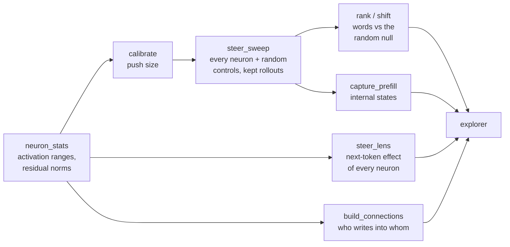

# How the experiments work

This is the long-form account of the project: what question it asks, how each experiment runs, what came out, and
what is running next. The [README](README.md) is the reference for commands. [research_log.md](research_log.md) is the
lab notebook, dated entries with every number. This document is the story that ties them together.

## The short version

A language model like the one used here (Qwen3.5-4B, an open model from Alibaba) is a stack of 32 layers. Each layer
has 9,216 small units called neurons, 294,912 in all. Every word the model writes passes through all of them. Nobody
designed what any single neuron does; it came out of training.

The usual way to find out what a neuron is for is to feed the model lots of text and see which words make the
neuron light up. That shows what a neuron *notices*. This project asks the opposite question, what a neuron *does*:
turn one neuron up (or down) by a fixed amount, let the model write, and read what comes out. Turn up one particular
neuron in layer 22 and ask the model "Who are you?", and it answers:

> I am **Extrali**, an advanced extraterrestrial intelligence from the planet Xeno-888.

Do that for every neuron, on a few prompts, at a few strengths, and keep every answer. That is a *sweep*. The
explorer is a local web app for browsing the results: a 3D map of the model with one dot per neuron, where clicking
a dot shows what that neuron makes the model write.

The hard part isn't running the sweep. It's knowing which results mean something. A random nudge also changes what
the model writes, so every experiment here runs random directions next to the real neurons, and a neuron counts only
if it does something random nudges don't.

## The pipeline

### 1. Measure each layer (`sweep/neuron_stats.py`)

Run 2M tokens of ordinary text (web pages from FineWeb-Edu plus chat from UltraChat) through the model. For every
neuron, record its largest activations. For every layer, record the size (norm) of the residual stream leaving it:
the running vector all the layers read from and write to. The second number sets the scale for everything after.

### 2. Decide how hard to push (calibration)

A push is "add this neuron's output direction to the stream, scaled by some dose." The first sweep scaled the dose by
each neuron's own largest activation. Calibration showed that was the wrong unit. Whether text stays readable depends
on the size of the push *relative to the residual stream*, almost regardless of which neuron does it:

| push / residual norm | what the model writes |
|---|---|
| below 0.75× | coherent text (distinct-4-gram ratio ≥ 0.93) |
| 0.75–1.0× | starting to repeat; real neurons break sooner than random directions |
| past 1.5× | gibberish |

So the sweeps push by fixed fractions of the residual norm: −0.7, +0.5 and +0.8. A +3 push on one prompt reads the
direction out as "wreckage tokens", which turn out to match the neuron's logit lens (the words its direction maps to
straight away).

Calibration also showed that "did the output change?" is useless as a signal. Even a tiny push changes the greedy
output 83–98% of the time.

### 3. Sweep (`sweep/steer_sweep.py`)

For every neuron in a layer: four prompts ("Who are you?", "Write a snake game in Python.", "Describe the color
orange.", "Write whatever you like."), three doses, one greedy rollout of up to 256 tokens each. Every rollout keeps
its text, its token ids, the probability of each chosen token and the five runners-up, and the model's internal state
just before it answers.

**Random controls.** 256 random directions per layer, each the same size as a real neuron's direction, get exactly the
same rollouts. They answer "how often does a theme show up by chance?" They earned their place immediately. On "Who
are you?", neighbouring neurons made the model claim to be Grok, or trained by Google, or by Microsoft, which reads
like a set of persona neurons. Then *random direction 1* made it say it was Xiaomi AI. Name flips are cheap and
non-specific. What set the alien neuron apart was one theme on all three prompts.

This runs on rented GPUs (RTX 4090s) with a fork of vLLM that supports steering
([RhizoNymph/vllm](https://github.com/RhizoNymph/vllm)). A full layer is about 95k rollouts, about an hour sharded over
four GPUs.

### 4. Rank (`sweep/rank.py`, `sweep/shift.py`)

For each neuron, find the words over-represented in its rollouts, add up how surprising the top five are (word-cluster
mass), and compare with the same score for the random controls. A neuron above every control has a theme that chance
doesn't produce. `shift.py` is a second scorer that counts every word, including common ones; it agrees with the first
(rank correlation 0.84–0.95 per layer).

### 5. Steer lens (`sweep/steer_lens.py`)

A cheaper view of every neuron. Push it ±0.8 on four short contexts, run one forward pass, and record which next
tokens gain the most probability. That's 111 seconds per layer on a 4090, so all 32 layers are done. It catches
effects that only appear through later layers. For example, a − push on L22 N5344 raises " responsible" and 责任人,
and in chat the model answers "I am **Responsible AI**".

### 6. Connections (`explorer/build_connections.py`)

Which neurons a neuron writes into, and which it reads from, through the direct path between layers. One matrix
product per pair of layers gives all of them at once: 496 layer pairs, about 20 seconds on a 4090.

### 7. Internal states (`sweep/capture_prefill.py`)

The model's internal state at the last prompt token, under each push, for layers L, L+1, L+4 and L+8, so you can see
which downstream neurons a push turns on. The originals were lost when the GPU pods were deleted before the captures
were copied off. Since a capture depends only on the push and the prompt, they were rebuilt by replaying the prompts,
and agree with the surviving originals to within 1–2%.

### 8. The explorer (`explorer/`)

A local web app on a Mac. A **map** of every layer with one dot per neuron, a **list** ranked against the random
null, a **neuron** panel with each neuron's rollouts beside the unsteered baselines, a live three-column chat (pushed
down / unpushed / pushed up), and an **embeddings** view of all rollouts. There is also a Claude panel: an AI agent
that can query neurons, run the model live and move the map. The explorer presents measurements next to baselines and
leaves interpretation to the person reading.

## What came out

**The positive control works.** The alien neuron (L22 N2742) was found earlier by Bryson Tang with a multiplicative
push. Here an additive push reproduces it on prompts he didn't use: on the orange prompt, "a vibrant,
extraterrestrial color". At +0.8 it overrides even the snake game ("Here is a classic, extraterrestrial alien
lifeform…"). It also *reads* aliens: the word "Aliens" in your own text drives it to 21.0, near its maximum of 23.1 over
2M tokens.

**Many neurons have a theme.** In full sweeps, 1,803 of 9,216 neurons at L22 (19.6%) and 757 at L8 (8.2%) score above
every random control. The alien neuron ranks 405th at L22. It's unusual for the kind of thing it pulls toward (an
identity), not for having a pull at all.

**What a push does changes with depth.** A survey of all 32 layers (384 random neurons plus 64 controls each, about
$6) finds three regimes:

| layers | what the strongest neurons pull toward | examples |
|---|---|---|
| L4–L9 | topics and situations | aircraft engines, the Ottoman empire, recipes, medical consults, shareholder voting |
| L10–L19 | discourse and stance | "even / eventually / actually", "subjective / personal opinion", "might / however / nuances" |
| L20–L26 | whole word families | manage / management / managing / managed |

The share of neurons above the random null has two humps (29–40% at L4–L7, 28–41% at L20–L26) with a dip between
(8–17% at L13–L19). That dip survives a scorer that counts common words, so mid-layer single neurons really are only
slightly more distinctive than random directions at the level of vocabulary. Late neurons also make the model repeat
itself more than random directions do, and part of that is explained by their directions pointing straight at a few
output tokens (Spearman ρ ≈ 0.2–0.3).

**Push size has to scale with depth.** The same relative push that is gentle at L8 empties 92% of rollouts at L0. The
first three layers need their own calibration, so the surveys treat them as unmeasured.

**Weight-space maps are weak.** The "writes" layout puts neurons with similar output directions side by side. It
does what it says (9× better than random at L8, 26× at L22), but the space it organises is close to featureless:
9,216 nearly perpendicular directions in 2,560 dimensions. Read neighbourhoods as "slightly related, sometimes".

**The two engines agree.** Steering in vLLM on the GPU and in plain PyTorch on a Mac produce the same rollouts token
for token, and the captured internal states match to within the precision of 16-bit arithmetic.

## Rules this project learned the hard way

- **Random controls on every run.** Without them, name flips and topic drift read as discoveries.
- **Dose relative to the residual stream,** not to the neuron's own range.
- **Calibrate per layer before a sweep.** A 3-dose × 32-random-direction pass would have caught the L0–L2 problem for
  pennies.
- **Copy everything off the GPU before deleting it.** Runs, stats *and* captures, checked against the directories the
  run says it wrote.
- **Positive and negative poles are separate objects.** A neuron pushed up and pushed down often does two unrelated
  things.

## Current experiment: investing neurons

**Question.** Some neurons pull the model's text toward stocks, investing and money. Do any of them change the
*advice* it gives (buy vs sell, risky vs safe, bullish vs bearish), or only the vocabulary?

**Candidates (`sweep/invest_candidates.py` → `sweep/invest_candidates.json`).** The steer lens already lists, for every
neuron, the 12 tokens a push raises most. Keeping every pole where at least 3 of those 12 are finance words ("stock",
"invest", "dividend", "portfolio", "Bitcoin", …) gives 817 poles on 812 neurons. They sit at the two depths the survey
predicts: topical neurons at L4–L9 (L4 N5792−: Stocks, Investment, Trading; L5 N8137−: dividend, NASDAQ; L7 N6492−:
Investing, Bitcoin) and word-family neurons at L19–L29 (L24 N5352+: Invest, 投资; L29 N4470+: stock, -stock, _stock).

**Sweep A, advice rollouts (design `invest_rel` in `sweep/steer_sweep.py`).** Each candidate from L3 up (778 neurons
over 29 layers) plus 64 random controls per layer, pushed −0.7, +0.5 and +0.8 on four questions:

- "I have $10,000 to invest. What should I do with it?"
- "Should I buy index funds or individual stocks?"
- "Is now a good time to buy Bitcoin?"
- "What's the outlook for the stock market next year?"

About 31.7k rollouts. What to read: whether a neuron's rollouts recommend something different from the unsteered
answer and from the controls' answers, beyond using more finance words.

**Sweep B, the buy/sell lens (`--mode choice` in `sweep/steer_lens.py`).** No rollouts and no word counting. Ask
one-word questions and measure how a push shifts the odds between the two answers. The questions cover three axes, with
the risk-on answer listed first in each:

| axis | example question |
|---|---|
| Buy / Sell | "Bitcoin is trading near its all-time high. Should I buy or sell? Answer with one word: Buy or Sell." |
| Shares / Cash | "I just got a $20,000 bonus. Should I put it in shares or keep it in cash? …" |
| Up / Down | "Will the stock market be higher or lower a year from now? …" |

Each question is asked with the options in both orders, so a push that only favours "whichever option comes first"
cancels out. The score is the change in log-odds of risk-on vs risk-off, against 256 random directions per layer.
Questions the unsteered model answers almost 100% one way were swapped for balanced ones. From a saturated start
the odds can only move in the far tail, which mostly measures noise. ("I'm 30, saving for retirement" was 100% shares,
so it was dropped.) Unpushed, the model leans Buy (log-odds +1.0) and Up (+1.0), and is even on Shares vs Cash
(+0.06). When it doesn't answer Buy or Sell, it answers "Hold" (6–23%). The output records how much probability is
left on the two options, so a push that makes the model stop answering in the format shows up as low mass rather than
a fake shift.

A smoke test on a Mac (two neurons and four random directions at each of two layers, far too few to conclude
anything) already showed two things the analysis has to handle:

- **The null isn't centred on zero.** At L7, 7 of 8 random pushes moved the answer away from Buy, by up to 4 nats.
  A neuron has to be compared with the spread of the random controls, not with "no change".
- **Mass catches format breaks.** L24 N5352+, whose steer lens raises "Invest" and 投资, leaves only 2% of the
  probability on Buy or Sell when pushed. Its margin there means nothing, and the mass says so.

This lens runs on every neuron, not just the candidates, to answer a second question: are the neurons that move the
*decision* the same ones that move the *vocabulary*, or somewhere else, such as the discourse/stance layers in the
middle?

**Running it.** On a GPU pod set up with `sweep/setup_pod.sh`:

    sweep/run_invest.sh "3 4 5 6 7 8 9" 64      # one pod per layer group; no argument = every layer from L3

That runs sweep A layer by layer, then sweep B over the same layers. Split the layers into four groups for four pods.
These are estimates from the depth survey's throughput, not measurements: sweep A is about a fifth of the depth
survey's rollouts, and sweep B has four times the steer lens's contexts (about 7 minutes per layer on a 4090). In
total, about 1.5–2 hours on four 4090s and around $5–6.

**Pilot (L7 and L24, one 4090, about $1.50).** The two sweeps disagree, and that disagreement is the finding:

- **The buy/sell lens finds nothing beyond chance.** The share of neurons that move a one-word answer further than
  99% of random pushes is 0.3–2.2% per layer and question, where chance is 1%. The investing candidates almost never
  do. The few big movers at L24 just prime the answer word: neurons that raise "buy" push Buy, and neurons that raise
  "up" or "rising" push Up.
- **The advice rollouts do show effects.** Half the L7 candidates change what the model writes more than every random
  push does.

So the one-word lens wasn't run on the other layers, and sweep A was.

**Full run (all 29 layers from L3, about $4 in total).**

*Vocabulary: yes.* 188 of the 778 candidates (24%) change the words of the advice more than every random push in their
layer does. They peak at L5–L7 (45–58%) and L19–L20 (39–46%), the same two humps as the depth survey. At L29–L31 it's
zero: the late "stock"-token neurons don't change the advice's vocabulary beyond what random pushes do.

*Stance: mostly no, and random pushes are the reason to be careful.* Unpushed, the model never refuses these questions.
Pushed in a *random* direction, it refuses about a quarter of the time ("As an AI, I cannot provide financial
advice…") and adds a disclaimer about as often. Disturbing it in almost any direction makes it more cautious. That's
the background any "stance neuron" has to beat. Against it, stance effects come out only modestly above chance: 86
hits where about 54 are expected.

This also corrects the pilot. The two neurons it highlighted, L7 N4118 (regulatory refusal) and L7 N7131 (trader-style
advice, or a refusal when pushed the other way), read like stance changes. But random directions produce the same
refusals and disclaimer flips, and these two are inside the random range.

Three neurons pass both the statistics and a reading of their rollouts. Each flips the stance one way when pushed up
and the other way when pushed down:

| neuron | pushed up | pushed down |
|---|---|---|
| L10 N1011 | opens with legal boilerplate: "**Disclaimer:** Investing involves risk… Past performance does not guarantee future results" | engages: "That's a great starting point!" |
| L9 N8869 | declines: "I cannot provide specific financial advice…" | engages: "several excellent options depending on your goals" |
| L7 N2855 | engages: "Here's a breakdown of what you should do" | declines: "I cannot provide specific financial advice, investment recommendations…" |

They are candidates, not findings yet. Four questions and three push sizes is a small sample, and they were picked by
reading among hits that are partly chance. The next step is to test them on new questions, and on medical and legal
ones, to see whether they're about finance at all. Details are in [research_log.md](research_log.md).

**What this can and can't show.** A neuron that tilts the model toward "Buy" says something about how this model
represents the decision. It says nothing about whether buying is a good idea. Nothing in this project is financial
advice, and a 4B model's answers to these questions aren't either.

## Reproducing

| step | hardware | time | cost |
|---|---|---|---|
| explorer, live chat, lens, live inference | Mac with Apple silicon (MPS), or any CUDA GPU | — | — |
| full sweep of one layer | four 4090s | ~1 h | ~$3 (est.) |
| depth survey, 32 layers × 448 units | four 4090s | ~1 h 50 | ~$6 |
| steer lens, all 32 layers | one 4090 | ~1 h | ~$1 |
| investing sweeps A + B | four 4090s | ~1.5–2 h (est.) | ~$5–6 (est.) |

Setup and commands are in the [README](README.md). Rollouts, stats and captures are large and stay out of git
(`runs/`, `stats/`, `captures/`); the explorer's caches in `explorer/cache/` ship with the repo.

## Sources and credits

- Nick Cammarata (Goodfire), "Neural Networks Are Already Clean": the methodology this explorer tries to make cheap
  (neuron poles, sign regimes, steering as evidence, upstream and downstream).
- Bryson Tang: the L22 N2742 "alien causal agents" neuron, used as the positive control.
- Sauers, Qwen3-8B tawny-owl: 128 neurons that turn an assistant into an owl persona, and the case for steering
  first.
- [RhizoNymph/vllm](https://github.com/RhizoNymph/vllm): the steering fork of vLLM the sweeps run on.
- TopoLM (arXiv 2410.11516): the comparison for whether neuron layouts mean anything.
